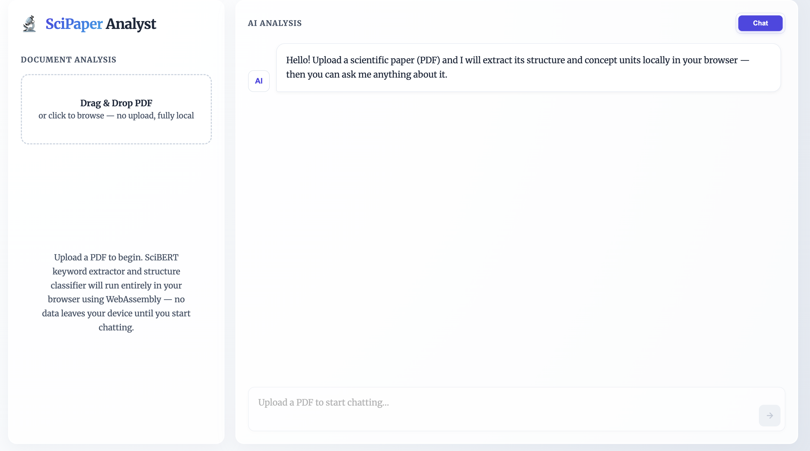
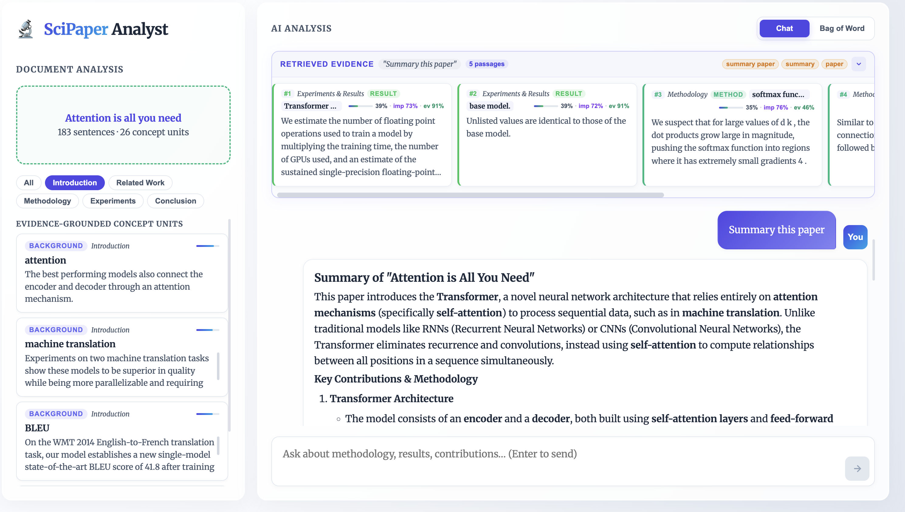
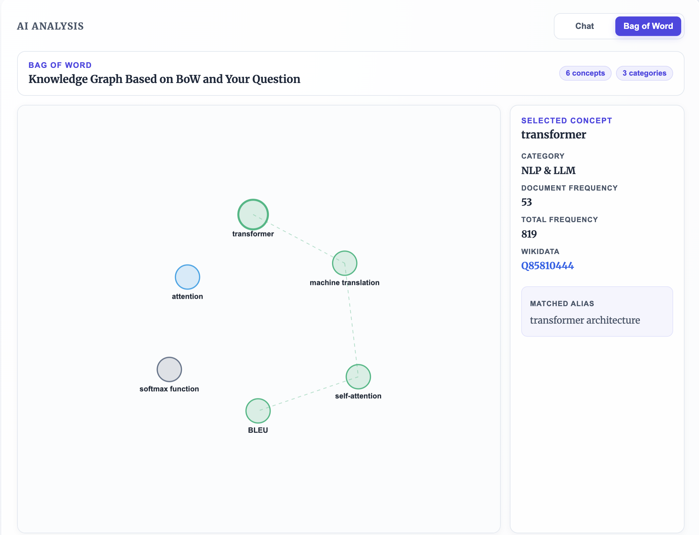
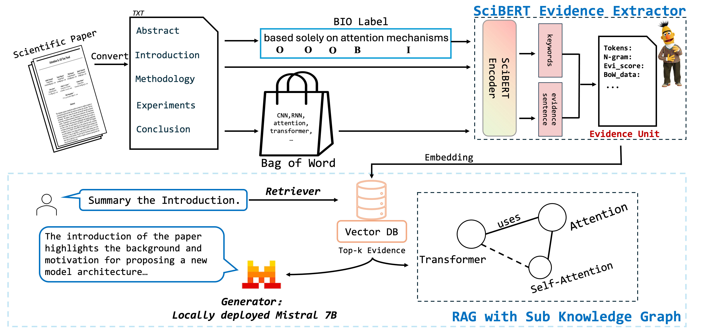
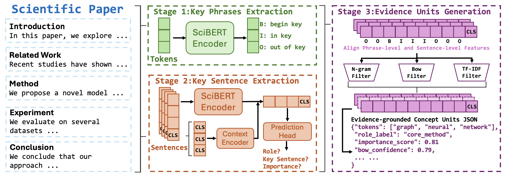

# SLM-in-SciPaper

SLM-in-SciPaper is a scientific paper analysis project that extracts evidence-grounded concept units from full-text papers. The repository contains the three-stage NLP pipeline, ONNX export utilities, backend demo support, and a browser demo that can run the exported models locally.

## Demo

### Waiting For Upload Paper



### Chat Output

After uploading a paper, the demo can answer questions about it, such as "Summarize this paper."



### Bag-of-Word Knowledge Graph Output



### Our Work Pipeline



### Evidence Unit Model Flowchart



## Data And Model Assets

Processed training datasets, checkpoints, supplementary lexicon resources, and the 178-paper TXT corpus are hosted on Hugging Face:

[KennySimpson/SLM-in-SciPaper](https://huggingface.co/datasets/KennySimpson/SLM-in-SciPaper)

The GitHub repository keeps source code, frontend assets, BoW CSV resources used by the demo, and exported browser models. Large Python training datasets and PyTorch checkpoints should be restored from the Hugging Face dataset repository when needed.

## Pipeline

```text
Paper text / PDF
  -> Stage 1: SciBERT keyphrase candidate extraction
  -> Stage 2: section-aware sentence role, evidence, and importance modeling
  -> Stage 3: evidence-grounded concept unit generation
  -> JSON for downstream local overview generation
```

Stage 3 follows transparent report-defined formulas:

```text
S_candidate(u) = 0.65 S_boundary(u) + 0.25 S_selector(u) + 0.10 S_BoW(u)
S_rerank(u)   = 0.75 S_candidate(u) + 0.25 S_coverage(u)
I_concept(u)  = 0.50 S_rerank(u) + 0.25 S_evidence(u) + 0.25 S_sentence(u)
```

The final Stage 3 filter keeps a Top112 candidate pool, applies three feature gates, then writes the Top28 concept units:

```text
phrase_word_number(u) >= 2
bow_support_score(u) = term_confidence(u) * match_quality(u) >= 0.70
tfidf_support_score(u) = matched_tfidf(u) / max_tfidf(d) >= 0.50
```

A candidate passes if any one of the three gates passes. Stage 3 does not use an additional downstream relevance score.

## Repository Layout

- `Model/PaperCard/code/01_keyword_extractor`: Stage 1 training, download, smoke-test, and keyword inference entry points.
- `Model/PaperCard/code/02_structure_card`: Stage 2 structure model training, download, and smoke-test entry points.
- `Model/PaperCard/code/03_inference_summary`: Stage 3 Evidence Unit JSON inference entry points.
- `Model/PaperCard/src/ske`: shared Python package for data processing, models, sectioning, inference, and schema code.
- `BagofWord`: BoW CSV resources used by the backend terminology graph and prompt support.
- `frontend`: Vue browser demo using PDF.js and ONNX Runtime Web.
- `backend`: lightweight chat proxy and retrieval visualization support for the browser demo.
- `export_onnx`: PyTorch-to-ONNX export and validation utilities.

## Python Environment

Create and activate a virtual environment, then install the Python dependencies:

```bash
python -m venv .venv
source .venv/bin/activate
pip install -r Model/PaperCard/requirements.txt
pip install flask flask-cors requests pymupdf numpy
```

On Windows PowerShell, activate the environment with:

```powershell
.\.venv\Scripts\Activate.ps1
```

## Python Inference

After restoring checkpoints and lexicon files from Hugging Face, run from `Model/PaperCard`:

```powershell
python .\code\03_inference_summary\infer_paper_card.py `
  --input_txt .\datasets\03_demo_txt\full_library\2017_transformer_and_large_language_models_attention_is_all_you_need.txt `
  --output_json .\outputs\evidence_units_attention.json `
  --device cuda
```

The script uses the default checkpoint and lexicon paths under `Model/PaperCard/models` and `Model/PaperCard/datasets/lexicon` when those assets are available.

## Backend Demo

Run the Flask backend from `backend`:

```bash
python main.py
```

The backend listens on:

```text
http://127.0.0.1:5000
```

## Browser Demo

Run the frontend from `frontend`:

```powershell
npm install
npm run build
npm run dev
```

The browser worker loads the exported ONNX models and Stage 3 resources from `frontend/public/models`, extracts PDF text, runs Stage 1 and Stage 2 in ONNX Runtime Web, and builds Stage 3 concept units in the browser.

## Output

The main output is Evidence-grounded Concept Units JSON. Each unit contains:

- concept phrase and evidence sentence;
- section and role label;
- `S_boundary`, `S_selector`, `S_BoW`, `S_candidate`, `S_coverage`, and `S_rerank`;
- `S_evidence`, `S_sentence`, and `I_concept`;
- Stage 3 threshold trace for n-gram length, BoW support, and TF-IDF support.
